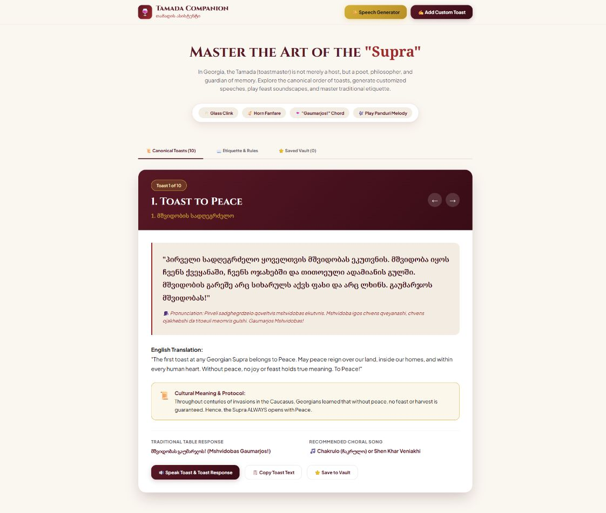
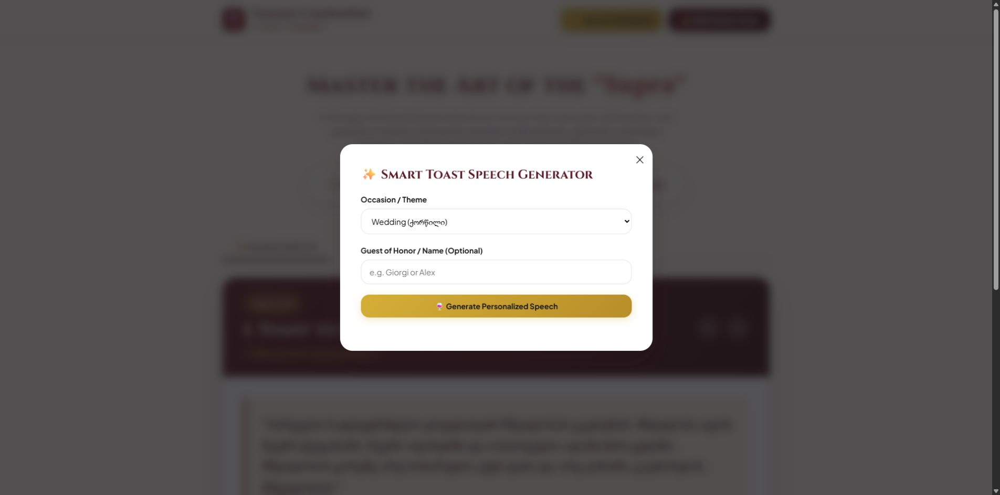
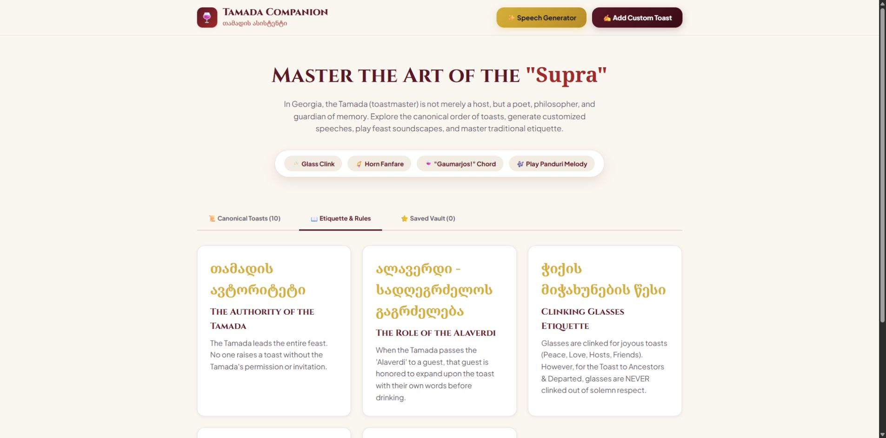

# Tamada Companion

Tamada Companion (`თამადის ასისტენტი`) is a local-first web guide to the structure, language, and etiquette of a Georgian supra. It presents bilingual toast material, pronunciation guidance, cultural notes, synthesized sound effects, and tools for preparing a toast.

> **Project status:** functional web prototype. The core guide, generator, soundboard, saved vault, and offline cache work in a modern browser. The custom-toast button and Android wrapper are not yet complete, and the cultural content still needs a formal expert review before the app should be treated as an authoritative reference.

## Product preview



| Speech generator | Etiquette guide |
| --- | --- |
|  |  |

## Current features

| Area | What is included |
| --- | --- |
| **Canonical toast guide** | Ten ordered toast cards with Georgian text, English translation, pronunciation guidance, cultural context, a traditional response, and a suggested song. |
| **Etiquette guide** | Five concise notes covering the Tamada's role, Alaverdi, glass-clinking etiquette, the Kantsi, and the response “Gaumarjos!” |
| **Speech generator** | Local templates for wedding, birthday, family, reunion, business, and general guest-focused occasions. |
| **Soundboard** | Browser-synthesized glass, horn, choral-chord, and Panduri-inspired sounds with no downloaded audio files. |
| **Saved vault** | Favorite canonical toasts saved in browser storage for quick access. |
| **Offline web app** | A web manifest and cache-first service worker for the current static assets. |

The interface also supports copying toast text to the clipboard. The visible **Add Custom Toast** control is not implemented yet and is tracked as roadmap work.

## Quick start

### Requirements

- Windows PowerShell 5.1 or PowerShell 7+
- A current browser with JavaScript modules and Web Audio support
- `localhost` or HTTPS for service-worker and clipboard behavior

### Run locally

```powershell
git clone https://github.com/DrKogMaw/tamada-companion.git
cd tamada-companion
.\server.ps1
```

Open <http://localhost:8081> and stop the server with `Ctrl+C` when finished.

Opening `index.html` directly is not recommended because module, service-worker, and clipboard behavior depends on browser security rules for the page origin.

## Data and privacy

The web app has no backend, accounts, analytics, advertising, or cloud synchronization. Saved toasts are stored under `tamada_saved_toasts` in browser `localStorage`. Generated speech content remains in the page unless the user copies it.

Clearing site data removes saved toasts and cached assets. Data does not automatically move between browsers or devices.

## Cultural scope

Georgian supra traditions vary by region, family, occasion, and religious or community context. The included order and explanations are educational summaries, not universal rules. Georgian language, transliteration, ceremonial claims, and suggested songs should be reviewed by qualified native speakers and cultural practitioners before a production release.

## Project structure

```text
tamada-companion/
├── index.html                 # Web entry document and service-worker registration
├── manifest.json              # Installable web-app metadata
├── sw.js                      # Static asset cache
├── server.ps1                # Local development server
├── styles/main.css           # Responsive visual system
├── js/
│   ├── app.js                # Rendering, navigation, generator, and persistence
│   ├── audio.js              # Web Audio synthesis
│   └── toastData.js          # Toast, etiquette, and occasion content
└── android-project/          # Incomplete Android WebView wrapper scaffold
```

See [Architecture](docs/ARCHITECTURE.md) before changing persistence, caching, audio, or the Android wrapper.

## Android status

`android-project` contains an Android application module and a WebView activity targeting `file:///android_asset/index.html`. It does **not** currently contain the required web assets, launcher resources, root build configuration, or Gradle wrapper, so it is not a reproducible Android build yet.

## Verification

There is no automated test suite. Before publishing a change, complete the checks in [Testing](docs/TESTING.md), including offline behavior, audio start/stop behavior, clipboard fallbacks, saved-vault persistence, content review, and narrow mobile layouts.

## Accessibility

The interface uses large controls, responsive cards, and clear visual grouping. A production release still needs dedicated keyboard, focus-management, screen-reader, contrast, zoom, reduced-motion, and audio-alternative testing.

## Roadmap

- Implement and validate custom-toast creation
- Add unit and browser-level automated tests
- Complete expert review of Georgian language and cultural guidance
- Add safe HTML escaping and stronger input handling for generated content
- Add cache versioning and service-worker update behavior
- Complete the Android wrapper and reproducible build process
- Perform a formal accessibility review
- Publish a versioned web demo

## Contributing

Read [CONTRIBUTING.md](CONTRIBUTING.md) before submitting changes. Cultural accuracy, respectful language, privacy, and clear separation between verified tradition and product interpretation are required review concerns.
